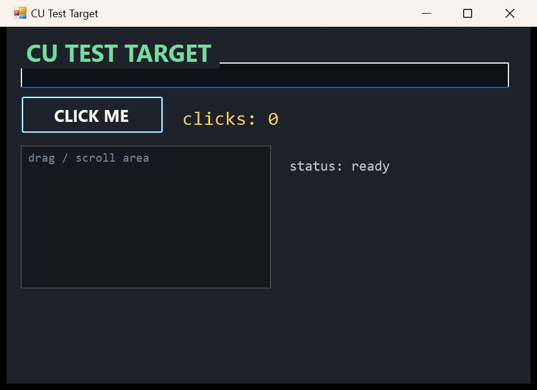
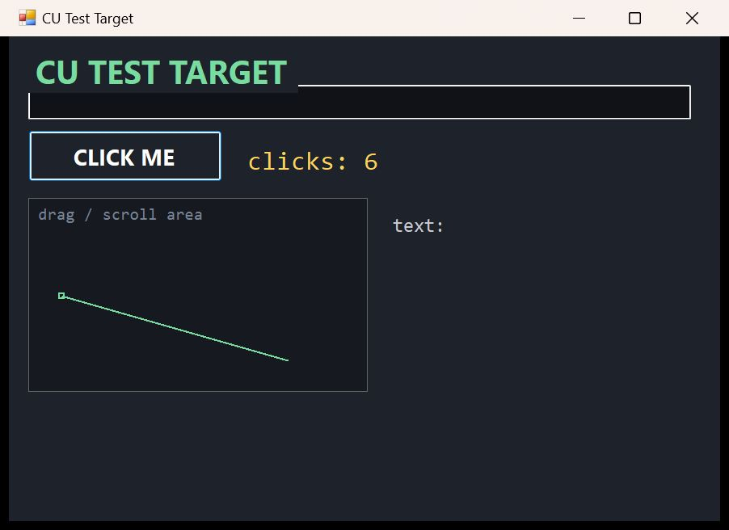

# 验证记录

本文件记录**实际跑过**的验证，以及可复现的命令。所有数字来自本机实测，不是估算。

## 1. 验证环境

| 项 | 值 |
|----|----|
| OS | Microsoft Windows NT 10.0.22631 |
| 显示器 | 1 台，2560×1600 物理 / 144 DPI（150% 缩放），主屏 |
| 会话 | 交互式（`WinSta0`，session 1） |
| Node | v24.15.0 |
| PowerShell | Windows PowerShell 5.1.22621 |
| 进程 DPI 感知 | Per-Monitor-V2（`GetAwarenessFromDpiAwarenessContext == 2`，已验证） |

> 注意：本机只有单屏，**混合 DPI 与负坐标副屏未做硬件验证**（代码路径已按物理像素 + origin 处理，并有单测覆盖负坐标数学）。

## 2. 自动化测试

### 2.1 单元测试（166 个，全通过）

```powershell
node --test "test/*.test.mjs"        # 166 tests
```

| 文件 | 覆盖 |
|------|------|
| `test/geometry.test.mjs` | token 预算、双约束缩放（2560×1600→1389×868、3840×2160→1456×819）、坐标映射、负原点、normalized 模式、越界拒绝、往返一致 |
| `test/policy.test.mjs` | preset 默认值、白名单匹配（exe/进程名/完整路径/`.exe` 省略）、deny 优先、内置拒绝、contains 需显式开启、策略文件加载与错误码 |
| `test/guards.test.mjs` | 组合键解析与别名、系统组合键识别、坐标校验、tier 拒绝文案（含反规避）、flag 缺失文案 |
| `test/mcp-protocol.test.mjs` | initialize 版本协商、tools.list、tools.call、handler 异常→isError、未知工具/方法、坏 JSON 后仍存活、cancelled、progress |
| `test/computer-use.test.mjs` | 用假引擎测决策层：无锚点拒绝、窗口移动→state_conflict、遮挡→target_occluded、同进程窗口放行、tier 分级、flag 门禁、输入通道选择（message/real/auto/强制/客户区外/多击/修饰键）、HWND 复用→target_identity_changed、批次先校验/首错停止/锚点不漂移、zoom 不改锚点、open_application 报 launched vs bound 与框架分类 |
| `test/window-classify.test.mjs` | 框架分类决策表：Chromium/WPF/WinUI/WinForms/JavaFX/Flutter/Unreal/Tk/自绘/Qt 不误匹配/大小写/未知类名回落 standard |
| `test/tools.test.mjs` | 工具面契约：恰好 27 个、无 desktop_info、`include_desktop`、单击工具 `input_channel` 三态、多击无通道参数、批次项通道、坐标模式改写描述 |
| `test/helper-protocol.test.mjs` | 提权助手协议（无 UAC 模拟）：管道连接、nonce 握手、ping/state、拒绝 app.launch、管道断开后退出、错误 nonce 被拒 |
| `test/lock.test.mjs` | 获取/释放、幂等、活进程占用→`lock_held`、死 PID 回收、损坏文件回收 |

### 2.2 MCP 协议冒烟（12 项，全通过）

```powershell
node tools/mcp-smoke.mjs        # SMOKE OK
```

握手 → 27 个工具 → `list_granted_applications(include_desktop:true)` → `request_access` → `list_windows` → `screenshot`（1389×868）→ `cursor_position` → `zoom` → 批次门禁 → 未知工具拒绝。

### 2.3 端到端真实输入（25 项，全通过）

```powershell
npm run e2e                     # E2E OK
```

靶场：`tools/test-target/CuTestTarget.cs`（自建 WinForms，Per-Monitor-V2，把每个输入事件写入 JSON 日志）。

| 断言 | 实测证据 |
|------|----------|
| `open_application` 绑定 | hwnd 与靶场自报一致，tier=full |
| 窗口截图 | 902×656，源 902×656，原点 160,160 |
| `get_window` | 进程 `CuTestTarget`，tier=full，dpiAwareness=per-monitor |
| `activate_window` | 返回已激活 |
| 窗口模式 `zoom` | 请求 `[100,100,300,250]` → 裁剪 200×150（修复前会返回整窗） |
| `left_click` | 靶场 `click` 日志 +1 |
| `type` 中文/emoji | 靶场 `textchanged` = `中文 😀 abc ABC 123 !@#` |
| `ctrl+a` + `BackSpace` | 文本变为空 |
| `right_click` | 靶场 `pad-mousedown button=Right` |
| `double_click` | 靶场 `click` +2 |
| `left_mouse_down` + `mouse_move` + `left_mouse_up` | `pad-mousedown` +1、`pad-mouseup` +2 |
| `hold_key` | 派发成功 |
| 长文本走剪贴板快路径 | 靶场收到 261 字符，文案为 `pasted via clipboard` |
| 粘贴后剪贴板恢复 | 前后长度一致（只比较长度与相等性，不记录内容） |
| `scroll` | 靶场 `pad-wheel` delta=-360（3 格×-120） |
| `left_click_drag` | 靶场 `pad-mouseup from=40,120` 且绘制线段终点 320,200 |
| `computer_batch`（2 次点击） | 靶场 `click` 4→6 |
| `wait` | "Waited 0.15s." |
| 越界坐标 | `Error (bad_args): Coordinate (99999, 99999) is outside the last screenshot` |
| 启动脚本被拒 | `evil.bat` 返回 `app_not_allowed`，且标记文件未被创建（证明没有执行） |
| 未授权应用 | `explorer.exe` 只能拿到 `tier=read` |
| `switch_display` | 回到全屏，`boundWindow=null` |
| 全屏截图 | 1389×868（源 2560×1600） |

截图证据（同一轮 e2e 的实际输出）：

| 动作前 | 动作后 |
|--------|--------|
|  |  |

动作后可见：`clicks: 6`、文本框已清空、拖拽区留有从 (40,120) 到 (320,200) 的线段——与工具请求完全一致。原始报告见 [`evidence/e2e-report.json`](evidence/e2e-report.json)。

### 2.4 绑定窗口输入通道（9 项，全通过）

```powershell
npm run e2e:channel
```

靶场：`tools/msg-target/MsgTarget.cs`（自建经典 USER32 顶层窗口 + `CuMsgPad` 自绘子窗口 + 原生 Button，把收到的消息与坐标写入日志）。可用第三个参数 `unaware` 启动一个 DPI-unaware 实例。

| 断言 | 实测证据 |
|------|----------|
| 经典窗口分类 | `framework=standard`、`mouseChannel=message`、`messageChannel.eligible=true` |
| posted 点击到达子窗口 | 靶场日志 `pad-down x=120 y=40 w=1` + `pad-up x=120 y=40 w=0` |
| posted 点击不动物理光标 | 光标 `144,144` → `144,144` |
| 文案标注通道 | `... via posted window messages to hwnd <...> (no cursor movement, no focus change)` |
| 强制真实点击命中原生按钮 | 靶场日志 `click 1` |
| 强制真实点击移动光标 | 光标到按钮中心 `311,370` |
| Chromium 只读分类 | `framework=chromium`、`frameworkMouse=real`（桌面无 Chrome 时 SKIP） |
| DPI-unaware 目标确实被系统虚拟化 | 自报 520px 逻辑 vs 引擎 780px 物理（×1.50） |
| **DPI-unaware 的 posted 点击坐标正确** | 靶场日志 `pad-up x=120 y=40`（不做二次缩放；早期实现会折成 80,27） |
| DPI-unaware 的 posted 点击不动光标 | 光标位置前后一致 |

证据：[`evidence/channel-report.json`](evidence/channel-report.json)、[`evidence/channel-target.log`](evidence/channel-target.log) 与 [`evidence/channel-window.jpg`](evidence/channel-window.jpg)（同一轮实际输出；运行目录 `test/artifacts/channel-*` 跑完即删，需要时重跑）。

### 2.5 提权通道（真实 UAC，10 项全通过）

```powershell
npm run e2e:elevation      # 需要两次 UAC 确认
```

靶场以**管理员身份**启动（真实高完整性），MCP 服务保持中等完整性，验证路由确实切到了提权助手：

| 断言 | 实测证据 |
|------|----------|
| 服务自身完整性 | `medium` |
| 高完整性窗口被识别 | `integrity=high` |
| 绑定触发提权 | `open_application` 成功，`activated=true` |
| 助手已连接 | `helper pid=33368 integrity=high` |
| 高完整性窗口截图 | 902×656，`method=printwindow`（经助手） |
| 点击到达 | 靶场 `click` 日志 +1 |
| 输入到达（中文+emoji） | 靶场 `textchanged` = `提权通道 OK 😀` |
| 批次经助手执行 | `click` 累计 3 |
| 普通目标仍走本地 | 全屏截图 `method=screen` |

复跑结论：收紧管道 ACL 之后，**真实 UAC 提权 e2e 再次 10/10 通过**（`elevated helper is connected — pid=28624 integrity=high`，14 次 op 后助手随管道断开退出）。证据：`docs/evidence/elevated-target.jpg`（高完整性靶场截图）、`docs/evidence/elevation-report.json`。助手侧日志（`~/.computer-use-win/elevated.log`）记录完整生命周期（下面是收紧 ACL 之后复跑的真实输出，可看到管道只授予了调用者用户）：

```
pipe ACL target sid(s): S-1-5-21-...-1001, S-1-5-21-...-1001
pipe created with explicit ACL (caller user only)
pipe DACL: jsr1813\jsr=ReadWrite, Synchronize
waiting up to 60000ms for a client
client connected
handshake accepted
client disconnected after 13 ops
```

实现过程中在这里踩到并修掉的关键问题（都是"只有真的提权才会暴露"的）：

1. 启动器退出码 0 只是"已启动"而非"已连接"——客户端必须继续轮询管道，否则误判为 `elevation_failed`。
2. 提权令牌的**默认**管道 DACL 不含用户 SID → 中等完整性客户端连不上。改用 8 参构造显式 ACL（用户 + Administrators + SYSTEM）。
3. 管道未用 `PipeOptions.Asynchronous` 却调用 `BeginWaitForConnection` → "管道未打开异步模式"。
4. 在 `EndWaitForConnection` **之前**创建 `StreamWriter` 会抛异常并静默杀死助手；必须先连接再建流。
5. 握手响应回显的是字面量 `'hello'` 而不是请求 id → 客户端永远等不到响应。
6. `opts` 被误用于类字段初始化（`#logPath`）→ 整个 MCP 服务启动即崩，表现为"第二次 UAC 不弹"。

### 2.6 与 doge-code 对齐的语义改进（本轮）

对照 doge-code 的实现，补齐了以下几处它做得更严谨的地方，并逐条加了测试：

| 改动 | 之前 | 现在 | 验证 |
|------|------|------|------|
| 坐标几何不外泄 | `list_windows`/`get_window` 返回 `rect`/`client` | 只返回身份与 `size{diagnosticOnly}` | 单测断言无 `rect`/`client` |
| 拖拽分级 | 起点/终点都要求 `full` | 起点 `click`、终点恒 `full`（含同窗口） | 单测：click 档可起拖但落点被拒；full 档端到端通过 |
| 按下/释放分级 | 都要求 `full` | 都是 `click`；按住移动才升 `full` | 单测：click 档可 down/up，type 仍被拒 |
| 释放优先 | 先门禁、后释放 | 先物理释放、再门禁；拒绝文案声明"已松开" | 单测：read 档下 `left_mouse_up` 仍发出 `input.up` |
| 残留键清理 | 只有显式 `release_all` | 输入被部分拒绝后，下一动作前自动 flush | 场景由批次/断连路径覆盖 |
| 前台激活 | 三级级联 | 增加 **Alt 轻敲**再试 | 手工：被抢焦点场景激活成功率提升 |
| 长文本 | 全部逐字 SendInput | ≥200 字符或含换行走剪贴板快路径（暂存/读回/恢复，失败回退） | e2e：261 字符到达且剪贴板恢复 |
| 提权管道 ACL | 用户 + Administrators + SYSTEM | **只授予调用者用户 SID** | 协议测试 + **真实 UAC 提权 e2e 复跑通过**（助手日志实测 DACL 仅 `jsr1813\jsr`） |
| 批次图片预算 | 触发预算的动作同时计入 completed 与 failed | 停止并报 `stoppedEarly`，计数自洽 | 代码审查项（预算需 20MiB 图才能触发，未做 e2e） |
| **绑定窗口绿色描边**（v5） | 无 | 不建窗口：`DwmSetWindowAttribute(hwnd, DWMWA_BORDER_COLOR=34)` 把系统边框染绿（`0x0046C02E`），解绑写回 `DWMWA_COLOR_DEFAULT`；合成器绘制，零延迟跟随、不占窗口外侧空间；Windows 11（22000+）能力，旧系统跳过且不发调用 | 单测：绑定调 `border.show`、`switch_display` 调 `border.hide`、flag 关闭时不调；实测：绑定后对物理屏幕抓屏，窗口边框一圈从 0 变成大量绿色像素，解绑后归零；记事本（WinUI 3）与网易云音乐（CEF）各验一次 |
| **物理 ESC 中止**（v3） | 无 | 引擎低级键盘钩子 + 计数；`wait`/`type`/`hold_key`/`batch` 在安全点中止；注入 ESC 忽略 | e2e：钩子真实注册，注入 ESC 打断 15s 的 `wait`（`user_aborted`） |`n| **click 档剪贴板防护**（v3） | 无 | 暂存+清空、每个动作前重清、离开/cleanup 恢复、读不到就拒绝 | e2e：OS 剪贴板在点击前为空、`read_clipboard` 返回暂存、`cleanup` 恢复 |
| 测试靶场 auto-exit | 用局部 `WinForms.Timer`，提权实例上不触发（实测残留 240s+） | 改用 `Threading.Timer` + `BeginInvoke(Close)`，并把解析值写进 `ready` 日志 | 普通实例 5s 自退；**提权实例实测 `exited:true, exitCode:0`**，日志 `auto-exit=30` |

### 2.7 中止与剪贴板防护（真实钩子 / 真实剪贴板，9 项全通过）

```powershell
npm run e2e:guards
```

服务以 click 档绑定靶场启动，`CU_ESC_TEST_INJECTED=1` 只在这条测试里打开（让钩子也统计注入按键，否则需要人按 ESC）。

| 断言 | 实测 |
|------|------|
| ESC 钩子已注册 | `abortHotkey {enabled:true, watching:true}` |
| 剪贴板防护开启 | `clipboardGuard {enabled:true}` |
| click 档绑定成功 | `tier=click` |
| 点击前剪贴板有内容 | OS 剪贴板 = `GUARD-SECRET` |
| 点击被派发 | `left click dispatched` |
| **点击时真实剪贴板已清空** | OS 剪贴板 = `""` |
| `read_clipboard` 返回暂存 | `{text:'GUARD-SECRET', stashed:true}` |
| **ESC 中止 `wait`** | `Error (user_aborted): Escape was pressed; the wait was cancelled.` |
| `cleanup` 恢复剪贴板 | OS 剪贴板 = `GUARD-SECRET` |

证据：`test/artifacts/guards-*/guards-report.json`（跑完即删，需要时重跑）。引擎侧逻辑另有一组单测（ESC 计数、batch 中止、防护清空/恢复/失败拒绝/读暂存、`desktop` 字段）。

### 2.8 绑定窗口描边（实测）

`open_application` 绑定窗口后，用独立进程对**物理屏幕**抓屏，统计窗口边框一圈内的绿色像素（绑定前 → 绑定后 → 解绑后）：

```
记事本 (WinUI 3)，顶边上沿 8px 带：        0 → 3462   → 0
网易云音乐 (CEF)，窗口四周 6px 环带：      0 → 12156  → 0
```

判定标准是"边框上真的出现 RGB(46,192,70)（即 `COLORREF 0x46C02E`）的像素"，而不是 `visible=True` 之类的状态位——v0.2.x 的自建分层窗口实现正是栽在这里：窗口存在、`IsWindowVisible` 为真、几何也对，却因为没设 `SetLayeredWindowAttributes` 而完全透明。现在改成 DWM 边框后没有自己的窗口；`border.state` 的 `error` 在 Windows 10（属性不支持）或 DWM 拒绝时都有内容，正常时为空。

## 3. 手工验证过的关键问题

这些问题无法用断言表达，但决定了实现方式。

### 3.1 DPI-unaware 窗口的 PrintWindow 缺陷（复现 + 修复）

用 PowerShell 5.1 起一个 900×620 的 WinForms 窗口（150% 缩放下物理尺寸 1350×930）：

- **修复前**：`PrintWindow` 返回 1350×930 画布，但内容只画在左上 900×620，其余纯黑——模型看到的画面与用户所见不符，按图坐标点击会偏。
- **修复后**：识别 `awareness==0 && monitorDpi>96 && className 命中 WindowsForms10.*`，把左上角内容双三次拉伸到整张物理画布；截图内容铺满，点击落点与视觉一致。
- **边界**：只对 `MainWindow` / `WindowsForms10.*` 归一化；其他 unaware 窗口不做裁剪，避免"定点归一化"变成"通用放大"。

### 3.2 合成消息按框架决定有效与否（实测）

同一个 WinForms 按钮：

| 方式 | 结果 |
|------|------|
| `SendMessage(WM_LBUTTONDOWN/UP)`（物理客户区坐标） | 无反应（clicks 仍为 0） |
| `SendMessage`（按 1.5 折算的逻辑坐标） | 无反应 |
| `PostMessage` | 无反应 |
| `BM_CLICK` | ✅ 生效 |
| 真实鼠标（`SetCursorPos` + `mouse_event`） | ✅ 生效 |

但经典 USER32 窗口相反。`tools/e2e-channel.mjs` 的靶场（自建 `CuMsgTarget` 顶层 + `CuMsgPad` 子窗口）实测：

| 通道 | 结果 |
|------|------|
| `PostMessage` 到该点命中的子窗口（`ChildWindowFromPointEx` 逐层解析） | ✅ 子窗口收到 `pad-down x=120 y=40 w=1` / `pad-up x=120 y=40 w=0`，物理光标不动 |
| 强制 `input_channel:"real"` 点原生 Button | ✅ `BN_CLICKED`，光标移到按钮中心 |

→ 结论不是"消息不可靠"，而是"消息是否可靠取决于框架"。因此绑定窗口时做一次框架分类：Chromium/WPF/WinUI/WinForms/JavaFX/Flutter/Unreal/Tk/自绘一律真实输入，standard 才允许 message 通道（`backgroundInput` flag 之外再加一层限制）。强制 message 打到已知忽略消息的框架直接报错，而不是静默无效。

**仍存在的边界**：原生 `Button` 在 `WM_LBUTTONUP` 时会核对自己的**物理**光标位置，所以当真实光标停在别处时，posted 点击可能不产生 `BN_CLICKED`（自绘子窗口、Edit/List 等按 lParam 处理的控件不受影响）。这类情况只能靠截图验证发现，再改用 `input_channel:"real"`。文档与错误文案都不承诺"posted 点击一定生效"。

**坐标不做 DPI 二次缩放**：`ScreenToClient` 返回的就是目标客户区坐标（Windows 按目标 DPI 感知虚拟化）。在 150% 屏上对 DPI-unaware 靶场实测：不缩放时子窗口收到 `(120,40)`（正确）；早期实现按显示器 DPI 再除 1.5，得到 `(80,27)`（错误，已修）。posted up 连续被拒时返回 `message_button_stuck` 并停用该绑定的 message 通道，避免目标一直以为鼠标按着。

### 3.3 后台进程抢前台会被拒绝

在目标窗口不是前台时直接 `SendInput` 键盘，文本落到了当时的前台窗口（一次真实的误投）。因此实现中：

- 键盘动作前必须**验证**前台是目标（轮询 8×70ms），失败返回 `foreground_required` 且不派发；
- 鼠标动作改为"命中校验"：该点命中必须属于目标（同进程视为同一目标），否则先尝试激活、仍不符则 `target_occluded`；
- 早期版本对鼠标也强制前台，导致大量本可成功的点击被拒——这是本次实现相对上游的一处刻意偏离。

### 3.4 常驻引擎的收益

| 方式 | 往返耗时 |
|------|----------|
| 每次新建 `powershell.exe` + `Add-Type` | ≈ 514 ms |
| 常驻引擎 `ping` | ≈ 2.4 ms |

## 4. 性能（本机实测，`node tools/probe.mjs`）

| 操作 | min | 中位 | max |
|------|-----|------|-----|
| 引擎启动（含 C# 编译，一次性） | — | ≈ 560 ms | — |
| 引擎 `ping`（直接调引擎，不含 MCP） | 0.4 | 0.5 | 23.4 |
| `screenshot`（全屏 2560×1600 → 1389×868） | 104.8 | 124.4 | 158.4 |
| `list_windows`（50 个） | 106.6 | 110.9 | 159.2 |
| `zoom`（区域） | 10.8 | 12.8 | 19.9 |
| `cursor_position` | 0.7 | 0.8 | 3.8 |
| `list_granted_applications`（读缓存 + 诊断块） | 0.8 | 1.2 | 24.2 |

全屏 JPEG 约 98–120 KB（随屏幕内容变化）。`list_windows` 是最贵的只读操作：每个窗口要 `DwmGetWindowAttribute` + `GetProcessImageFileName` + `GetMonitorInfo`。已做两处优化：单次快照内进程/显示器缓存（160ms→111ms），以及显示器枚举 1 秒缓存；**权限判定用的单窗口查询不走缓存**，避免 PID 复用导致过期身份。

`node tools/probe.mjs` 同时输出 MCP 层（`timings`）与引擎层（`engine`）两组数字。

## 5. 未验证 / 已知缺口

| 项 | 状态 | 说明 |
|----|------|------|
| 混合 DPI 多屏 | ❌ 未验证 | 只有单屏硬件；负坐标数学有单测 |
| 高完整性（管理员）目标 | ✅ 已验证 | 经 UAC 启动的提权助手完成截图/点击/输入（见 2.5）；SYSTEM / TrustedInstaller 仍不可控 |
| UAC 安全桌面 | ❌ 不自动化 | 设计上拒绝；UAC 确认本身必须人工点击 |
| 硬件加速窗口（Chromium/Qt） | ⚠️ 部分 | PrintWindow 通常可用；黑图 + 遮挡会明确报错；这些框架只走真实输入（分类器已识别） |
| posted 消息对原生 Button 等"核对物理光标"的控件 | ⚠️ 有限 | 见 3.2 边界；需截图验证或改用 `input_channel:"real"` |
| UWP / 商店应用 | ⚠️ 部分 | 需先启动再按标题绑定 |
| 长期运行稳定性 | ⚠️ 未压测 | 未连续运行数小时验证句柄/内存 |
| 多 agent 并发 | ✅ 设计+单测 | 输入互斥；读操作并行；未做多进程实测 |

## 6. 复现全部验证

```powershell
cd E:\ClaudeCode\computer_use_win
node src/server.mjs --check          # 环境自检
node --test "test/*.test.mjs"        # 166 单测
node tools/mcp-smoke.mjs             # MCP 冒烟
powershell -NoProfile -ExecutionPolicy Bypass -File tools/test-target/build.ps1
node tools/e2e-input.mjs             # 真实输入 e2e（会短暂弹出测试窗口）
powershell -NoProfile -ExecutionPolicy Bypass -File tools/msg-target/build.ps1
node tools/e2e-channel.mjs           # 输入通道 e2e（同上）
node tools/probe.mjs                 # 性能
```

## 7. 独立评审驱动的修复

实现完成后做过两轮独立评审（代码 / 文档），以下是**评审发现且已修复**的问题。记录在此，一是留痕，二是提醒后来者这些地方脆弱。

| 问题 | 影响 | 修复 |
|------|------|------|
| `open_application` 先启动、后做策略判定 | `.bat`/任意路径 = 绕过 tier 的任意代码执行 | 先 `app.resolve` 解析真实文件 → 要求 `.exe` → 按解析后身份做策略判定（≥ click）→ 才 `Start-Process`；无窗口时改报 `launched_no_window`（含 pid） |
| 系统组合键用字符串精确匹配 | `shift+ctrl+esc`、`ctrl+shift+escape`、`lwin+r` 都能绕过 `systemKeyCombos` | 修饰键排序 + 别名/键名归一后再判定；新增 `alt+shift+tab`、`ctrl+alt+tab`、`alt+f1..f24` |
| 策略解析 fail-open | `"tier":"clik"` 会变成 `full`；`"preset":"Safe"` 会回落到 standard；`limits` 写成字符串会让所有限制失效 | 未知 tier/preset/flag/limit 一律 `policy_invalid`；预设名大小写归一；限额必须是正整数 |
| 引擎被 kill 时 `release_all` 送不到 | 崩溃/超时后鼠标或修饰键可能物理卡住 | 引擎退出与 stdin EOF 时主动 `ForceIdle()`；客户端 kill 后由独立进程 `release.ps1` 再兜底扫一遍 |
| `drag` 终点未做命中/tier 校验 | 绑定窗口内起拖、落到 deny 应用的窗口 | 终点单独 hit-test 并做 tier 判定 |
| 按住按钮时 `mouse_move` 不升档 | read 档下可对其它窗口产生 drag-over 副作用 | 会话跟踪 `#buttonHeld`，按住时按 `full` 判定并做命中校验 |
| 内部 `shutdown` handler 可通过 `tools/call` 调用；原型键可命中 | 会话中途被清空、锁被释放；`constructor` 之类被当函数 | 只允许调用 `tools/list` 里声明过的工具 |
| `EngineClient.start()` 竞态 | 可能同时 spawn 两个 PowerShell；旧进程 exit 会清空新进程状态；启动超时泄漏进程 | 共享 in-flight promise；事件绑定到具体 proc 实例；超时即 kill |
| 重启上限语义错误 | "每次启动成功后崩溃"永远不受限 | 按"60 秒内崩溃次数"限流 |
| `save_to_disk` schema 与 handler 不一致 | 存档静默失效 | 同时接受 `save_to_disk` / `saveToDisk` |
| 点击修饰键解析拒绝了合法输入 | `text:"shift"` 直接报错 | 独立的宽松修饰键解析 |
| `request_access` 谎报 effectiveFlags | 模型以为剪贴板可用 | 只报告策略真实值 |
| 显示器拓扑不刷新 | RDP/改分辨率后 `switch_display` 可能抓错屏 | `switch_display`/`include_desktop` 前刷新；显示器枚举 1 秒缓存 |
| 跨进程锁文件非原子 | 极小窗口内两个进程可同时持锁 | 目录级原子创建 + owner 文件 |
| `scroll_amount:0` 仍滚一格、`repeat` 只 sleep 不间隔、`\n` 不发换行 | 行为与文档不符 | 0 不发事件；repeat 逐次发送；`\n` 归一为 `\r` |

仍然开放（已在 README 限制一节说明）：混合 DPI 硬件矩阵、高完整性目标提权助手、UI Automation、审计日志、长期稳定性压测。
```
